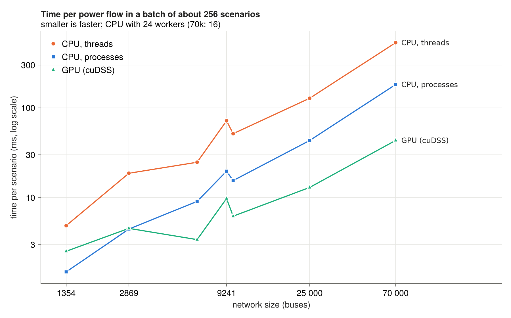
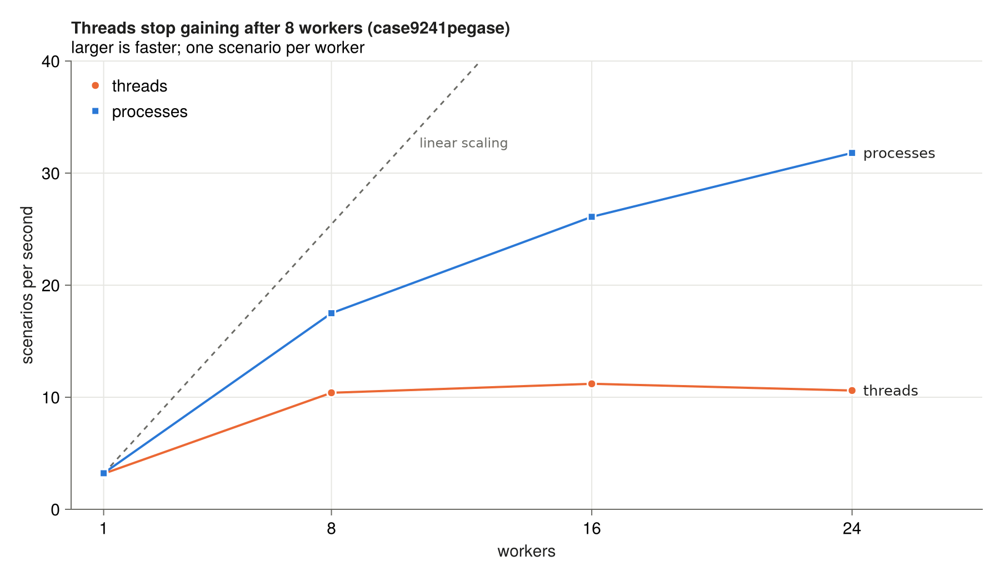
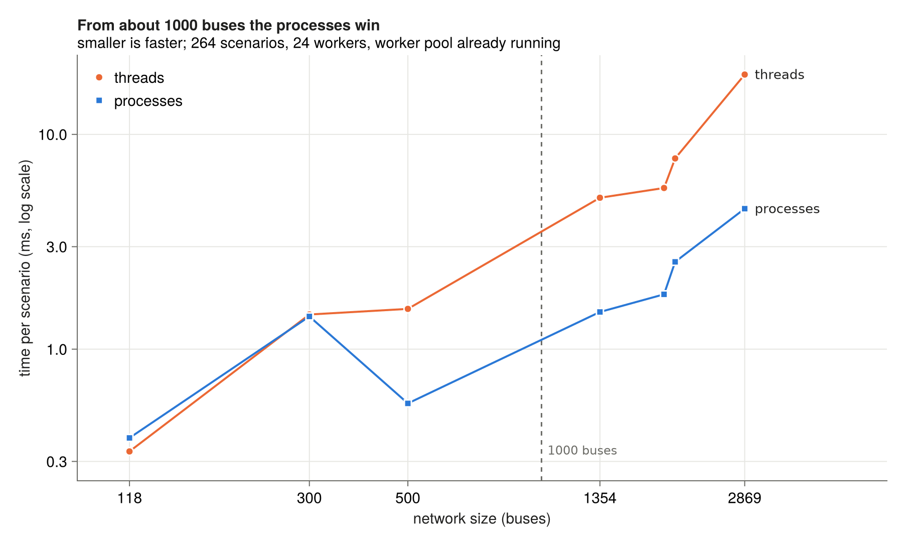
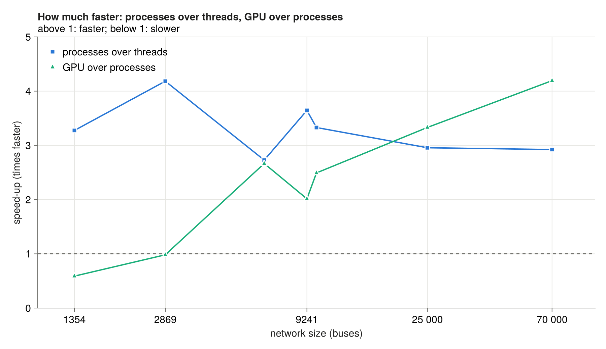

# Batches of power flows on one workstation: processes, threads and a GPU

Udo Schmitz (SOPTIM AG), November 2026. Numbers measured on Sparlectra 1.3.0 unless a
section names another state; the current release is 1.3.1. Scripts and result files are in this
repository; see "Sources of the numbers" at the end.

## Summary

The short version, for readers who stop here:

- **Processes instead of threads: about 3 times faster.** A batch of AC
  power flows (N-1 cases, load scenarios) runs 2.7 to 4.2 times faster on
  24 cores when each worker is a separate Julia process instead of a thread
  of one process. This holds for every network measured, from 1354 to
  70 000 buses (Figure 1). Threads stop gaining after about 8 workers;
  processes keep gaining up to 24 (Figure 2).
- **Why.** The threads queue at the memory allocator lock of OpenBLAS,
  which the sparse LU (UMFPACK) calls in every factorization. Each process
  has its own OpenBLAS and does not share the lock. More OpenBLAS threads
  per solve do not help; one per solve is best (Table 4).
- **The GPU pays off on large networks.** With the cuDSS sparse solver the
  GPU is up to 4.2 times faster than the CPU with processes (ACTIVSg70k:
  43 ms instead of 182 ms per scenario), from about 3000 buses on. Below
  that, the CPU with processes is as fast or faster (Figure 3).
- **Same results.** GPU and CPU results differ only in the twelfth decimal
  place, and a repeated run gives exactly the same result.
- **When processes pay off.** Once the worker pool runs, processes win
  from about 1000 buses on. Starting the pool costs about 6 s, so a single
  batch that has to start it needs several hundred to a few thousand
  scenarios before it gains (Figure 4).
- **Available** in Sparlectra: batches pick processes or threads by
  themselves (`runtime.parallel.executor = auto`). Since 1.3.1 the rule
  follows this measurement: processes from 1000 buses when the pool already
  runs or the batch is large enough to pay its start, otherwise threads.

The sections below give the method, the cause, the cost of processes, the
GPU details and the limits.



## 1. Method

- **Terms.** A worker is one parallel unit of a batch: a thread or a
  process. The worker processes form a pool (see section 4).
- **Software.** Sparlectra.jl 1.3.0 [1] on Julia [7], function `runInjectionBatch` with the keyword `executor`
  (`:threads` or `:processes`). Newton-Raphson in polar update, sparse LU by
  UMFPACK [8] with one OpenBLAS [9] thread inside the batch, GC pause on (the default:
  the Julia collector is off while a batch runs, with a memory guard). The
  GPU path is the sequential solver loop of `benchmark/gpu/batch_study_gpu.jl`
  with cuDSS [10], double precision, deterministic mode.
- **Machine.** Intel Core Ultra 9 285 (8 P and 16 E cores, 24 threads),
  124 GB RAM, NVIDIA RTX PRO 4000 Blackwell SFF (24 GB). Julia 1.13.3,
  OpenBLAS, CUDA.jl 6.5.1, CUDSS.jl 1.0.0 (libcudss 1.0.0).
- **Networks.** MATPOWER 8.1 case files [2]: case1354pegase,
  case2869pegase, case9241pegase (PEGASE [3, 4]), case6495rte (RTE [3]) and
  the synthetic ACTIVSg10k, ACTIVSg25k, ACTIVSg70k [5, 6]; for the executor
  crossover also case118, case300, ACTIVSg500, case1888rte and ACTIVSg2000.
  The files are byte-identical to the ones in MATPOWER 8.1 (SHA-256 in
  `scripts/download_cases.jl`).
- **Workload.** Load scenarios from `random_load_scenarios`: every load
  scaled by a random factor in a band of 20 percent, seed 1. CPU: 24
  workers with 11 scenarios each (N = 264); ACTIVSg70k 16 workers with 16
  each (N = 256), chosen for memory.
  GPU: N = 256. Same generator and seed on both sides; the sets differ in
  their length.
- **Start.** Every scenario starts from the voltages stored in the case
  file (the solved operating point of the MATPOWER case), as a batch of
  N-1 or load cases starts from the base case.
- **Statistic.** Median of 5 calls after one uncounted first call. The tables give the time per scenario in milliseconds (smaller is faster), computed from the throughput in
  scenarios per second. CPU: N over the wall time of one
  `runInjectionBatch` call; the process pool is started once before and is
  counted apart. GPU: N over the wall time of the whole call, setup
  included, device synchronized before and after.
- **Scripts.** CPU: `scripts/cpu_batch.jl` of this repository. GPU:
  `benchmark/gpu/batch_study_gpu.jl` of Sparlectra 1.3.0. One Julia process
  per case and executor, measured on 2026-11-22 with no other measurement
  running at the same time (`scripts/run_all.sh` shows the calls).

## 2. Processes against threads

Table 1. Time per scenario in milliseconds (wall time of the whole batch
divided by the number of scenarios; smaller is faster), 24 workers, about
256 scenarios per batch, Sparlectra 1.3.0. The last column says how many
times faster the processes are.

| Network | Buses | Threads, ms per scenario | Processes, ms per scenario | Processes faster by |
|---|---|---|---|---|
| case1354pegase | 1354 | 4.88 | 1.49 | 3.3 x |
| case2869pegase | 2869 | 18.7 | 4.47 | 4.2 x |
| case6495rte | 6495 | 24.8 | 9.09 | 2.7 x |
| case9241pegase | 9241 | 71.8 | 19.7 | 3.6 x |
| ACTIVSg10k | 10000 | 51.6 | 15.5 | 3.3 x |
| ACTIVSg25k | 25000 | 128 | 43.3 | 3.0 x |
| ACTIVSg70k (16 workers) | 70000 | 532 | 182 | 2.9 x |

The same in throughput: threads 1.9 to 205 scenarios per second,
processes 5.5 to 671 scenarios per second.

All scenarios converged in every call. The numbers agree within 2 percent
with a run on the development state two days before the release.

**Threads saturate at 8 workers.** A series with one scenario per worker
(N = k, development state shortly before 1.3.0, same statistic) shows where the threads
stop. On case9241pegase:

Throughput in scenarios per second (larger is faster), one scenario per
worker:

| Workers | 1 | 8 | 16 | 24 |
|---|---|---|---|---|
| Threads, scenarios/s | 3.18 | 10.4 | 11.2 | 10.6 |
| Processes, scenarios/s | 3.22 | 17.5 | 26.1 | 31.8 |



Scaling efficiency, throughput(k) / (k throughput(1)), at 24 workers on the
cases from case1354pegase up: threads 0.14 to 0.19, processes 0.26 to 0.46
(ACTIVSg70k at 16 workers: 0.25 against 0.62). Processes stay well below
linear as well: 24 solves share the memory bandwidth of one socket, and a
single scenario per worker leaves the per-batch cost unshared. With
N = k = 24 the process factor is 1.7 to 3.0 from case118 on. On case14 the
threads win (factor 0.30): a scenario takes about 0.2 ms, less than the
dispatch to another process.

## 3. Why threads serialize

UMFPACK's numeric factorization works on dense frontal matrices and calls
OpenBLAS (`dgemm`, `dtrsm`) for them. OpenBLAS takes a global mutex,
`alloc_lock`, in `blas_memory_alloc` and `blas_memory_free` on every such
call to hand out its work buffer. With many threads in one process every
factorization queues at that lock. Measured on ACTIVSg70k with 8 threads
(development state before 1.3.0):

- Profile with the GC off: 6730 of 12719 samples inside
  `umfpack_dl_numeric` are in `blas_memory_alloc` or `blas_memory_free`.
- strace: about 92,000 futex calls per scenario; with one thread none.
- Voluntary context switches per round: 1.34 to 1.38 million with
  OpenBLAS and the GC off, 30 to 112 with MKL and the GC off.

The second lock is the stop-the-world of the Julia GC: a thread inside the
`ccall` to UMFPACK reaches a safepoint only at its next allocation. On
ACTIVSg70k with 8 threads the summed time to safepoint is 3.4 to 3.8 s per
round, 0 with one thread. The GC pause takes it out of the batch except for
the guard collections. Removing one lock alone helps little; MKL and GC off
together reach the process numbers on ACTIVSg70k.
MKL is not a standard library and is no option for the package. Page
faults, glibc malloc, mmap volume, GC threads and the heap size hint were
measured and ruled out. A separate process has its own OpenBLAS buffer pool
and its own GC, so the processes do not meet at either lock.

**Is it the number of OpenBLAS threads?** The Julia build of OpenBLAS on
this machine allows up to 512 threads (`MAX_THREADS=512`) and starts
with 12. Inside a batch Sparlectra gives each solve one BLAS thread
(`blas_threads = 1`, the default of `runInjectionBatch`), so the workers do
not share an OpenBLAS thread pool. Table 4 changes that setting. More BLAS
threads per solve do not help the thread executor, and with processes they
cost a lot, because 24 workers with 8 BLAS threads each put 192 threads on
24 cores. The thread executor is also slower with 24 workers than with 8:
every added thread adds waiting at the lock. One BLAS thread per solve is
the best setting for both executors.

Table 4. Time per scenario in milliseconds (smaller is faster), 264
scenarios, Sparlectra 1.3.0, BLAS threads per solve set with the keyword
`blas_threads` of `runInjectionBatch`.

| Network | Executor, workers | 1 BLAS thread | 2 BLAS threads | 8 BLAS threads |
|---|---|---|---|---|
| case2869pegase | threads, 8 | 13.7 | 15.1 | 16.1 |
| case2869pegase | threads, 24 | 19.0 | 19.4 | 19.4 |
| case2869pegase | processes, 24 | 4.49 | 4.77 | 7.60 |
| case9241pegase | threads, 8 | 58.7 | 56.7 | 62.8 |
| case9241pegase | threads, 24 | 74.6 | 75.1 | 74.7 |
| case9241pegase | processes, 24 | 20.6 | 29.8 | 144 |

## 4. Cost of processes

The worker processes are not started per scenario but once, as a worker
pool: a fixed group of Julia processes that lives until the end of the
session. Each process loads Sparlectra once at its start and then solves
the scenarios it is given. A running pool serves several batches in turn.

- **Pool start.** 6.0 to 6.3 s for 24 workers, 5.2 s for 16, once per
  session. Estimated from the medians of Table 1, a single batch that pays
  the start is faster than threads from about 120 scenarios on
  case9241pegase, 70 on ACTIVSg25k and 15 on ACTIVSg70k, but only from about
  1800 on case1354pegase. The pool pays off when it serves several batches.
- **Memory.** Summed peak resident size of the workers, GC pause on:
  40.4 to 42.4 GB at 24 workers, 32.4 GB at 16 workers on ACTIVSg70k. The
  thread process peaks at 95.3 GB on ACTIVSg70k (N = 256). Each worker
  holds its own copy of the network.

**When processes pay off on smaller networks.** The executor crossover
series runs threads and processes with 24 workers on networks from 118 to
2869 buses with 24, 72 and 264 scenarios per batch (Figure 4, Table 3).
With the pool already running, processes win from case1354pegase on at
every batch size, by 1.3 to 4.2 times. Below 1000 buses the picture is
mixed: on case118, case300 and ACTIVSg500 the order changes with the batch
size (threads are faster at 24 scenarios on case300, processes at 24 on
case118), because a scenario takes only 0.3 to 3 ms and the dispatch to
another process weighs as much as the solve. A batch that
has to start the pool first (about 6 s) gains only from about 400 to 500
scenarios on case2869pegase and from about 1100 to 3200 scenarios on the
networks of 1354 to 2000 buses.

Table 3. Time per scenario in milliseconds at 264 scenarios (smaller is
faster), 24 workers, pool already running, Sparlectra 1.3.0.

| Network | Buses | Threads, ms per scenario | Processes, ms per scenario | Processes faster by |
|---|---|---|---|---|
| case118 | 118 | 0.334 | 0.386 | 0.87 x |
| case300 | 300 | 1.45 | 1.42 | 1.0 x |
| ACTIVSg500 | 500 | 1.54 | 0.559 | 2.8 x |
| case1354pegase | 1354 | 5.07 | 1.49 | 3.4 x |
| case1888rte | 1888 | 5.63 | 1.80 | 3.1 x |
| ACTIVSg2000 | 2000 | 7.73 | 2.55 | 3.0 x |
| case2869pegase | 2869 | 19.0 | 4.51 | 4.2 x |



The `auto` setting of 1.3.0 switched to processes from 2000 buses. Since
1.3.1 it follows this measurement: processes from 1000 buses when the pool
already runs or the batch is large enough to pay its start, otherwise
threads.

## 5. The GPU

Table 2. Time per scenario in milliseconds (smaller is faster): GPU
sequential (cuDSS, deterministic) at 256 scenarios against the CPU with 24
worker processes at about 256 scenarios, Sparlectra 1.3.0. A factor below 1
means the GPU is slower.

| Network | Buses | Processes, ms per scenario | GPU, ms per scenario | GPU faster than processes by |
|---|---|---|---|---|
| case1354pegase | 1354 | 1.49 | 2.53 | 0.59 x |
| case2869pegase | 2869 | 4.47 | 4.55 | 0.98 x |
| case6495rte | 6495 | 9.09 | 3.41 | 2.7 x |
| case9241pegase | 9241 | 19.7 | 9.78 | 2.0 x |
| ACTIVSg10k | 10000 | 15.5 | 6.22 | 2.5 x |
| ACTIVSg25k | 25000 | 43.3 | 13.0 | 3.3 x |
| ACTIVSg70k | 70000 | 182 | 43.4 | 4.2 x |



The break-even against processes is at about 3000 buses; below, the CPU
with processes is as fast or faster. Device memory at N = 256 is 0.59 GB on
case1354pegase and 7.28 GB on ACTIVSg70k.

In Sparlectra the GPU is an optional extension: it is loaded with
`using CUDA, CUDSS`, and without these packages Sparlectra is unchanged.
With `power_flow.compute_backend.mode = auto` the network size decides from
the measurements of this study; the GPU is taken only where it was at least
1.2 times faster. Without a usable GPU the solve runs on the CPU and the
reason is recorded.

## 6. Accuracy and determinism

Each GPU run is checked against the CPU path of the same version on the same
scenarios. Largest voltage difference 1.8e-12 pu in magnitude and 2.7e-10
degrees in angle, both on ACTIVSg70k (Sparlectra 1.3.0). Convergence, iteration counts and
Q-limit flags are equal in every case. In deterministic mode the five
repeats are bit-identical (one distinct result per case).

## 7. Limitations of this study

- One machine; other machines give other numbers. The E cores are slower
  than the P cores, and the efficiency figures mix both.
- Load scenarios only. N-1 batches use the same executor path but are not
  in these tables. The GPU batch so far exists for load scenarios only.
- The process pool is not started per batch in Table 1; section 4 gives
  the start cost.
- The power mode configuration of the GPU study was run on threads only.
- During development the GPU rows got 6 to 25 percent faster between an
  earlier GPU state and the release; the cause is open (the GC pause does
  not explain it).
- CPU and GPU scenario sets come from the same generator and seed but have
  different lengths (264 against 256).
- Host memory of the GPU runs is not recorded.

## Sources of the numbers

All files below `results/`; `results/evaluation.md` is written from them by
`scripts/evaluate.jl`.

| Item | File | State |
|---|---|---|
| Table 1, Table 3, pool start, worker memory | `cpu_scaling_n256.csv`, `crossover.csv` | 1.3.0 |
| Table 2, accuracy, determinism, device memory | `batch_cold.csv` | 1.3.0 |
| Table 4 (OpenBLAS threads per solve) | `blas_threads.csv` | 1.3.0 |
| Thread saturation, efficiency, N = k factors | `cpu_scaling_one_per_worker.csv` | before 1.3.0 |
| Lock evidence | `lock_evidence/profile_70k_t8_gcoff.txt`, `lock_evidence/strace_counts.csv`, `lock_evidence/fault_probe.csv`, `lock_evidence/fault_probe_gc.csv` | before 1.3.0 |

Pool break-even sizes in section 4 are computed from the medians of the
1.3.0 files. The case files are not
part of the repository; `scripts/download_cases.jl` loads them from MATPOWER
8.1 and checks them against the files that were measured.

## Acknowledgments

The author thanks SOPTIM AG for sponsoring the workstation used for the
measurements and for its support of this work.

## References

1. Schmitz, Udo: Sparlectra.jl: A Power-Flow and State-Estimation Framework
   in Julia, 2026, https://github.com/Welthulk/Sparlectra.jl, version
   1.3.0.
   ```bibtex
   @software{sparlectra_jl,
     title  = {Sparlectra.jl: A Power-Flow and State-Estimation Framework in Julia},
     author = {Schmitz, Udo},
     year   = {2026},
     url    = {https://github.com/Welthulk/Sparlectra.jl}
   }
   ```
2. R. D. Zimmerman, C. E. Murillo-Sanchez, and R. J. Thomas, "MATPOWER:
   Steady-State Operations, Planning and Analysis Tools for Power Systems
   Research and Education," IEEE Transactions on Power Systems, 26(1),
   12-19, 2011. https://doi.org/10.1109/TPWRS.2010.2051168
3. C. Josz, S. Fliscounakis, J. Maeght, and P. Panciatici, "AC Power Flow
   Data in MATPOWER and QCQP Format: iTesla, RTE Snapshots, and PEGASE,"
   https://arxiv.org/abs/1603.01533 (case1354pegase, case2869pegase,
   case9241pegase, case1888rte, case6495rte).
4. S. Fliscounakis, P. Panciatici, F. Capitanescu, and L. Wehenkel,
   "Contingency ranking with respect to overloads in very large power
   systems taking into account uncertainty, preventive and corrective
   actions," IEEE Transactions on Power Systems, 28(4), 4909-4917, 2013.
   https://doi.org/10.1109/TPWRS.2013.2251015 (PEGASE cases).
5. A. B. Birchfield, T. Xu, K. M. Gegner, K. S. Shetye, and T. J. Overbye,
   "Grid Structural Characteristics as Validation Criteria for Synthetic
   Networks," IEEE Transactions on Power Systems, 32(4), 3258-3265, 2017
   (ACTIVSg500, ACTIVSg2000, ACTIVSg10k, ACTIVSg25k, ACTIVSg70k).
6. A. B. Birchfield, T. Xu, and T. J. Overbye, "Power Flow Convergence and
   Reactive Power Planning in the Creation of Large Synthetic Grids," IEEE
   Transactions on Power Systems, 2018.
   https://doi.org/10.1109/TPWRS.2018.2813525 (ACTIVSg70k).
7. J. Bezanson, A. Edelman, S. Karpinski, and V. B. Shah, "Julia: A Fresh
   Approach to Numerical Computing," SIAM Review, 59(1), 65-98, 2017.
   https://doi.org/10.1137/141000671
8. T. A. Davis, "Algorithm 832: UMFPACK V4.3, an Unsymmetric-Pattern
   Multifrontal Method," ACM Transactions on Mathematical Software, 30(2),
   196-199, 2004. https://doi.org/10.1145/992200.992206
9. OpenBLAS, an optimized BLAS library, https://www.openblas.net (version
   0.3.30 as shipped with Julia 1.13.3).
10. NVIDIA cuDSS, CUDA direct sparse solver library,
    https://developer.nvidia.com/cudss (libcudss 1.0.0 through CUDSS.jl).
